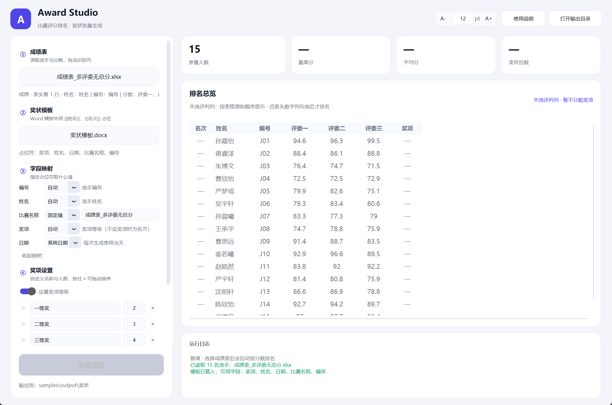

# Award Studio · 比赛评分与奖状生成

读一张 Excel 成绩表，自动按分数排名，再按 Word 模板给前 N 名批量生成奖状。界面用 CustomTkinter 写成，浅色、圆角卡片风格，双击即用。


## 它能做什么

- **自动认表**：表头不在第 1 行也能认（前面有标题、说明行无所谓），「姓名 / 选手 / 参赛者」「总分 / 成绩 / 得分 / 评分」这些列名都能识别
- **自动算分**：没有「总分」列、只有多个评委列时，直接把评委分相加；读不到缓存值时还能对 `=SUM(...)` 公式兜底计算
- **排名表跟着表格走**：列由成绩表的实际字段决定（名次 + 原始各列 + 总分 + 奖项），不是固定模板；整列没值的字段自动不显示
- **排序并列**：同分并列名次（1、2、2、4），前三名金/银/铜底色
- **批量出证**：获奖者每人一份 Word，文件名形如 `01_张三_一等奖.docx`，也可以额外生成一份多页合并版
- **字段映射**：模板里每个占位符都能单独指定来源，共六种——表格列、固定值、系统日期、指定日期、奖项、名次
- **拖进来就能用**：成绩表和模板可以直接从资源管理器拖到窗口里，不用点按钮找路径
- **界面字号**：右上角可直接输入 10–28 pt，也能用 A- / A+ 逐级调；调字号不改窗口大小，选完自动记住
- **奖项自定义**：奖项名称和人数都能改（特等奖 1 名、一等奖 3 名……），随时增删；关掉奖项就只排名次
- **一个工作簿多个项目**：一个项目一个工作表也行，在右上角下拉里切换，各自排名、各自分名额、各自输出子目录
- **集体项目两种发证方式**：默认一队一份，姓名栏放全体队员；勾上「集体每人一份」则一队 8 人出 8 份，文件名带队伍、编号自动加 `-1…-8`
- **项目组 / 参赛项目占位符**：`{{项目组}}`、`{{参赛项目}}`、`{{代表队}}` 自动从表里取，个人项目没有队伍时用「单位」顶上
- **不怕同名**：同分同名（不同单位）时奖状文件名自动加后缀，不会互相覆盖
- **没填分数也能打开**：只要有姓名列就能加载、浏览名单；分数缺了不影响打开，排名时自动跳过
- **缺分数会提示**：勾选排名依据后，缺分的人排在末尾、名次显示「—」，标题旁提示「N 人缺分数」
- **只给部分人排名**：表格第一列是勾选框，可以按住左键拖出一段、也可以逐行点选，只对选中的人排名发奖
- **支持套印模板**：文字放在 Word 文本框（浮动形状）里的奖状也能识别占位符，替换时不动字体字号


## 下载安装

到 [Releases](https://github.com/pick3t/award-studio/releases/latest) 直接下现成的：

| 平台 | 文件 | 打开方式 |
|---|---|---|
| Windows 10 / 11（64 位） | `AwardStudio.exe` | 双击运行，绝大多数电脑用这个 |
| Windows 10（32 位） | `AwardStudio-x86.exe` | 老的 32 位系统用这个，功能完全一样 |
| macOS（Apple Silicon） | `AwardStudio-macOS.zip` | 解压后把 `AwardStudio.app` 拖进「应用程序」 |

不确定自己用的是哪种 Windows？「设置 → 系统 → 关于 → 系统类型」，显示「64 位操作系统」就用第一个。Windows 11 只有 64 位，不存在 32 位版本。

这些包都没做代码签名，所以：

- **Windows** 首次运行会提示「已保护你的电脑」，点「更多信息 → 仍要运行」即可
- **macOS** 首次会被 Gatekeeper 拦住，在 Finder 里**右键**点 App → 打开 → 再点「打开」，或执行一次 `xattr -dr com.apple.quarantine /Applications/AwardStudio.app`

> macOS 版本目前使用系统默认应用图标（Windows 版已是自定义图标）。
>
> macOS 目前只构建 Apple Silicon（M 系列）版本。Intel Mac 可以 clone 仓库后 `python app.py` 运行，或把 `.github/workflows/build.yml` 里的 `macos-latest` 改成 `macos-13` 自行构建。
>
> 打 `v*` 标签会自动触发 Actions 构建两个平台并附加到 Release；也可以在 Actions 页面手动运行 `Build Release`。

## 快速开始

**方式一：直接运行 exe（推荐给非开发同学）**

双击 `dist/AwardStudio.exe` 即可，不需要装 Python。`samples` 文件夹是可选的——放在 exe 旁边，就能在软件里挑现成的成绩表和模板试跑（7 张表、6 份模板，见下方「测试数据」）；不放也不影响正常使用。

**方式二：双击 `启动.bat`**

会自动检查依赖，缺什么装什么，然后打开界面并载入示例数据。

**方式三：命令行**

```bash
pip install -r requirements.txt
python app.py            # 正常启动
python app.py --demo     # 启动并自动载入 samples 里的测试数据
```

> 想自己重新打包 exe（用仓库里的 spec，别手写参数 —— 少写 `--add-data` 会导致图标和 logo 失效）：
> ```bash
> pip install -r requirements.txt pyinstaller
> python -m PyInstaller AwardStudio.spec --noconfirm --clean
> ```
> 产物在 `dist/AwardStudio.exe`。

## 使用步骤

1. **选成绩表**：点「选择 Excel 成绩表」，或者直接把文件拖进窗口，也可以把 xlsx 拖到 exe 图标上直接打开。选完先把名单列出来，**排名等你点表头勾选评判列之后才算**
2. **选奖状模板**：点「选择 Word 奖状模板」，界面会显示模板里认到的占位符，下方的字段映射随之自动展开
3. **配映射**：模板里每个 `{{占位符}}` 都会列出来，逐行选来源，只有六种：

   | 来源 | 取什么 |
   |---|---|
   | 表格列 | 成绩表里真实存在的某一列（也会按叫法对号，如「参赛项目」找「项目名称」、「代表队」找「单位」） |
   | 固定值 | 自己填的文字，比如比赛全称、颁发单位 |
   | 系统日期 | 生成当天 |
   | 指定日期 | 用日历挑一天 |
   | 奖项 | 奖项设置里自定义的奖项（金/银/铜…）；没设奖项时填名次 |
   | 名次 | 按分数排出来的「第X名」 |

   所以模板写 `{{名次中文}}` 但想印「金奖」，把来源选成「奖项」即可；想印「第一名」就选「名次」。主办方、比赛全称这类不该写死的内容，直接选「固定值」自己填
4. **设奖项**：默认「一等奖 1 名、二等奖 2 名、三等奖 3 名」，名称和人数都能直接改，点「＋ 添加奖项」继续加；关掉「设置奖项等级」则只排名次，奖状里不填奖项
5. **选输出目录**：默认放在成绩表同级的 `output/奖状`；旁边的「集体每人一份」决定集体项目是按人拆还是全队写一张
6. **（可选）只对部分人排名**：在排名表第一列勾选，或按住左键从上往下拖出一段；表头「选」点一下可全选/取消
7. **点「生成奖状」**：完成后可直接打开输出文件夹；双击排名表里某一行，能打开这个人已生成的奖状

## 奖状模板怎么写

把模板里的固定内容照常排好，需要填空的位置写占位符（`{{姓名}}` 和 `【姓名】` 两种写法都认）：

| 占位符 | 内容 | 示例 |
|---|---|---|
| `{{姓名}}` | 选手姓名 | 何清越 |
| `{{名次}}` | 名次数字 | 3 |
| `{{名次中文}}` | 中文名次 | 第三名 |
| `{{奖项}}` | 奖项等级；不设奖项时自动填「第 X 名」 | 二等奖 / 第三名 |
| `{{比赛名称}}` | 比赛名称 | 2026 校园科技创新大赛 |
| `{{日期}}` | 生成日期 | 2026 年 10 月 21 日 |
| `{{编号}}` | 选手编号 | C024 |
| `{{项目组}}` | 工作表对应的项目组（表头上方那行） | 传统南拳类 第一场地 第4 组 |
| `{{参赛项目}}` | 项目名称 / 参赛项目 | 南拳道一路 |
| `{{代表队}}` | 集体项目的队名；个人项目自动用「单位」 | 镇海九龙山水太极辅导站 |
| `{{班级}}` | 成绩表里的任意列 | 高二(5)班 |

最后一类很实用：成绩表里 `班级`、`作品名称`、`指导老师` 这些列，都能用 `{{列名}}` 直接写进奖状。

模板不限版式，横向 A4、竖版、带边框、带校徽图片都行。占位符被 Word 拆成好几段格式（比如姓名单独加粗）也不影响替换。

用文本框（插入 → 文本框）排版**套印模板**同样可以：占位符写在文本框里也能认到，替换时只改文字，字号、字体、位置都不动。

### 奖项怎么分配

按分数从高到低依次往下分，**同分的选手一定拿同一个奖**：设「特等奖 1 名、一等奖 3 名」，第 1 名特等奖、第 2–4 名一等奖。

如果同分的人数超过某个奖项的名额，会整组按该奖项发放，并在奖项设置下方用橙色文字提示，比如：

> 「二等奖」设了 2 名，但有 3 人同分并列；「三等奖」设了 3 名，实际只能发 2 名。建议按实际人数调整上面的奖项设置。

这时把二等奖人数改成 3 即可。

表格里的「奖项」列和奖状里的 `{{奖项}}` 用的是同一套结果。关掉奖项后，`{{奖项}}` 会填成「第三名」这样的名次说法，所以模板里写「荣获 {{奖项}}」在两种模式下都读得通。

## 排名依据怎么定

排名表每一列的表头都可以点，带数字的列点一下会打上 `✓`，表示用它作为排名依据：

- **只勾一列**（比如某一位评委的分数）：直接按这一列排序，原来的「总分」列变成「排名分」
- **勾多列**（比如三位评委）：表格里自动多出「合计」和「平均」两列，按合计排名
- **勾「总分」**：按 Excel 里算好的综合分排名
- **一列都不勾**：完全不排序，名次和奖项都显示「—」，行顺序就是 Excel 里的原始顺序；程序里没有任何默认的评判列

没勾任何列时，「最高分 / 平均分 / 奖状份数」也都是「—」，生成按钮是灰的 —— 因为还不知道按哪一列评判。想开始排名，点一下表头里任意带数字的列即可；再点一下取消，表格就回到原始顺序。



上图就是刚载入成绩表的样子：名次、奖项全是「—」，行顺序和 Excel 一模一样。

「总分」和单独某列是互斥的 —— 因为总分本身就是各列之和，同时勾选没有意义。程序会自动帮你切换。

列多了表头可能显示不全，用表格底部的横向滚动条左右拖即可，不需要压缩列宽。

## 一个工作簿里有多个项目

比赛成绩单常常是「一个项目一个工作表」（一场地1组、一场地2组、集体项目…）。
软件会列出工作簿里的全部工作表，在「排名总览」右上角的下拉里切换：

- 每个项目**单独排名、单独算名额**，互不影响
- 生成奖状时自动分目录：`output/奖状/一场地1组/01_张三_一等奖.docx`
- 集体项目按「代表队」发奖，队名自动去掉换行与多余空格
- 集体项目的「参赛选手」按空格拆开，**每人一份奖状**（文件名带上代表队，编号自动加 -1、-2 后缀）
  - 约定：**队员之间用一个空格分隔，两字姓名中间不要空格**（如 `张锐 李佩 王峰`），程序只按空格拆，不做猜测
- 表头竖着拆成两行（第 3 行「最后」+ 第 4 行「得分」）也能识别

没有真实成绩想先试流程，可以跑：

```
python tools/fill_scores.py            # 填随机分 + 规整队员名单，另存 _模拟分数.xlsx
```

原文件不会被改动，副本放在 `samples/真实场地/`。脚本会顺带修两种队员名单的录入问题：
`张  锐` → `张锐`（两字名被空格劈开）、`徐泽宁王琦超` → `徐泽宁 王琦超`（两人粘在一起）。

## 成绩表长什么样

`samples/决赛评分表.xlsx` 就是一份可以直接用的示例，结构如下：

| 编号 | 姓名 | 班级 | 作品名称 | 评委一 | 评委二 | 评委三 | 总分 |
|---|---|---|---|---|---|---|---|
| C001 | 何清越 | 高二(5)班 | 智能垃圾分类装置 | 96.1 | 96.2 | 96.2 | `=SUM(E2:G2)` |

- 表头上方可以有标题、说明行，软件在前 20 行里定位表头
- 列顺序随意，多余列会被忽略
- 分数可以带单位（`95.5 分`），空分数的那行会跳过并在日志里提示

## 测试数据

`samples/` 里有默认示例（32 名选手、三位评委）和一批覆盖各种情况的素材，可以直接拿来试：

| 成绩表 | 用来验证 |
|---|---|
| `决赛评分表.xlsx` | 默认示例，带标题行与总分（SUM 公式） |
| `成绩表_两列最简.xlsx` | 只有姓名和分数两列 |
| `成绩表_带说明行.xlsx` | 表头在第 4 行，前面有标题和说明 |
| `成绩表_多评委无总分.xlsx` | 只有评委一/二/三，没有总分列（自动求和） |
| `成绩表_100人大名单.xlsx` | 100 人，测大名单与名额滑块 |
| `成绩表_同分并列.xlsx` | 第 2–4 名同分，测并列名次 |
| `成绩表_列名别名.xlsx` | 列名叫「选手 / 得分」，分数带「分」字 |

| 奖状模板 | 版式 |
|---|---|
| `奖状模板.docx` | 默认示例：A4 横向、金色双线边框 |
| `模板_竖版简约.docx` | A4 竖向、细红边框 |
| `模板_横版带徽章.docx` | 横版，顶部带徽章图片，落款用颁发单位 |
| `模板_方括号占位.docx` | 用 `【姓名】` 这种方括号写法，无边框 |
| `模板_表格排版.docx` | 证书信息用表格排版，验证单元格里的占位符 |
| `奖状模板_项目组.docx` | 竖版金边，带 `{{项目组}}` / `{{参赛项目}}` / `{{代表队}}`，适合按项目发奖 |

```bash
python tools/make_samples.py        # 重新生成默认示例
python tools/make_more_samples.py   # 重新生成上面那批变体
python tools/smoke_test.py          # 无界面跑一遍：读表 → 排名 → 出证 → 校验
```

自测会检查：人数、分数解析、降序排列、并列名次、占位符替换、单人文件与合并版是否完整。

## 项目结构

```
AwardStudio/
├── app.py                      界面主程序（CustomTkinter）
├── core/
│   ├── excel_reader.py         成绩表解析（表头定位、列识别、多评委求和）
│   ├── formula.py              SUM 等公式兜底求值
│   ├── ranking.py              排名、并列名次、奖项分配与人数冲突检测
│   ├── certificate.py          占位符替换、批量生成、合并多页
│   ├── fields.py               占位符字段映射规则
│   └── settings.py             字号、奖项、映射的本地持久化
├── tools/
│   ├── make_samples.py         生成默认测试数据
│   ├── make_more_samples.py    生成多场景测试数据（6 表 4 模板）
│   ├── smoke_test.py           端到端自测
│   ├── preview_gui.py          界面截图
│   ├── render_sample_preview.py  奖状效果图渲染
│   ├── capture_window.py       窗口截图（开发用）
│   ├── make_icon.py            生成应用图标
│   ├── make_template.py        生成带项目组占位符的模板
│   ├── fill_scores.py          批量填随机分 + 规整队员名单
│   ├── check_ranking.py        自测：不勾选就不排序
│   └── check_sheets.py         自测：多工作表 / 两行表头 / 逐人发证
├── assets/                     图标与 DPI 感知清单
├── samples/                    测试数据
├── output/                     生成的奖状（不入库）
├── docs/                       文档截图
├── dist/                       打包产物（不入库）
├── requirements.txt
├── 启动.bat
└── 重新生成测试数据.bat
```

## 常见问题

**读不到分数？** 分数列必须有表头，且表头里要出现「分 / 成绩 / 得分 / 评分 / 评委」这类字——「评委一」「评委二」这种会被当作多评委列自动相加。如果那一列是文本（比如 `A`、`优`），软件没法排序，会在日志里提示跳过了哪几行。

**模板生成失败？** 多半是模板里没有占位符。选完模板后看左栏「字段映射」：列出了每个占位符才说明认到了。文本框里的占位符也支持；页眉页脚、表格单元格同样会扫描。

**提示文件被占用？** 同名奖状正在 Word 里打开着，关掉再生成。

**奖项人数加起来超过选手人数？** 多出来的会自动忽略，左栏总名额旁边会提示。想少发几份，把某个奖项的人数改小或删掉那一行即可。

**分数没填完能先打开看名单吗？** 能。只要有「姓名」列就能加载；勾选排名依据后，有分的人正常排名，缺分的人排在最后、名次显示「—」、不参与发奖，标题旁会提示「N 人缺分数」。

**只想给一部分人排名怎么办？** 在排名表第一列点勾选，或者按住左键从上往下拖出一段，选中的人参与排名，其余人排到末尾不参与；点表头「选」可一键全选/取消。

**集体项目为什么奖状份数比队数多？** 因为你勾了「集体每人一份」：一队 8 名队员就出 8 份。不勾选时默认一队一份，姓名栏里放全体队员（用空格分开），文件名用队名。

**两字姓名被拆成两个人？** 「参赛选手」列有约定：**队员之间一个空格，两字姓名中间不要空格**。写成 `张  锐` 会被拆成「张」「锐」两个单字名，写成 `徐泽宁王琦超` 会被当成一个人。程序只按空格拆，不做猜测。

**同分怎么排名次？** 同分同名次，后面的名次跳号（1、2、2、2、5）。发奖时同分的人一定拿同一个奖，因此实际人数可能和设置的名额对不上，这时奖项设置下方会出现橙色提示，按提示改人数即可。

## 更新记录

**v1.4.0**

- 字段映射来源简化为六种：表格列 / 固定值 / 系统日期 / 指定日期 / 奖项 / 名次（去掉了原来的「自动」）
- 支持文字写在文本框里的套印模板（之前会报「模板里没有发现可替换的占位符」）
- 修复合并版多页时每页都显示最后一页内容：合并后统一重排文本框形状 id（Word 要求全文档唯一）
- `{{分数}}` / `{{成绩}}` 现在也能直接写进模板
- 新增「集体每人一份」勾选项（输出位置旁）：不勾（默认）时一队一张、姓名栏放全体队员；勾选后每人一张
- 一队一张且模板有多个姓名框时，队员名单会**按行平均分配**（8 人 → 4+4），不再挤在一行溢出
- 一队一张时奖状文件名只用队名，避免一长串名字
- `generate_all` / `expand_entries` 增加 `per_person` 参数

**v1.3.0**

- 缺分数也能加载：只要求表头有「姓名」列，分数列可以没有或有空缺
- 勾选排名依据后，缺分的人排在末尾、名次显示「—」、不参与发奖，标题旁提示「N 人缺分数」
- 排名表新增「选」列：可逐行勾选、按住左键拖出一段，只对选中的人排名
- 表头在「全选 / 取消」之间切换：点「取消」清空选择（此时生成按钮置灰），再点「全选」恢复全员
- 新增 `tools/check_selection.py` 覆盖上述三种情况

**v1.2.2**

- 修复 macOS / Linux 上「生成完是否打开输出文件夹」报错 `module 'os' has no attribute 'startfile'`
  （改为 Windows 用 startfile、macOS 用 open、Linux 用 xdg-open）
- 双击排名表打开单份奖状同样受益

**v1.2.1**

- 队员拆分回归一行 `split()`：程序只按空格切，正确性由成绩表约定保证（不再做空格数量猜测）
- 修复「翁素维  张月珍」这类相邻两人被粘成一个名字的问题
- `tools/fill_scores.py` 增加队员名单规整：`张  锐` → `张锐`、`徐泽宁王琦超` → `徐泽宁 王琦超`

**v1.2.0**

- 支持一个工作簿里多个工作表：每个项目单独排名、单独发奖、单独输出子目录（排名总览右上角切换）
- 兼容两行合并表头（「最后」+「得分」）
- 集体项目按「代表队」发奖，队名自动去掉换行与空格；姓名里的多余空格一并清洗
- 同分同名时奖状文件不再互相覆盖
- 集体项目按队员逐人发证，证书编号自动区分（如 6-1 … 6-8）
- 新增奖状模板 `samples/奖状模板_项目组.docx`，含 {{项目组}}、{{参赛项目}}、{{代表队}} 占位符
- 新增 `tools/fill_scores.py`（填模拟分数）、`tools/make_template.py`（生成模板）与 `tools/check_sheets.py`（多表自测）

**v1.1.2**

- 修复打包版里左上角 logo 与窗口图标回退成字母「A」：CI 打包时漏了 `assets/` 资源
- CI 三个平台的打包命令都补上 `--add-data`，与本地 `AwardStudio.spec` 保持一致

**v1.1.1**

- 新应用图标：奖状 + 金印，16–256px 逐尺寸渲染
- 修复打包后窗口/任务栏图标被 CustomTkinter 默认图标覆盖的问题
- 界面左上角 logo 改用图标本体，不再是字母「A」

**v1.1.0**

- 排名依据完全由用户勾选：点表头带数字的列即可作为评判依据，可多选，多选时自动算「合计」「平均」并按合计排名
- 一列都不勾时完全不排序：名次、奖项显示「—」，行顺序与 Excel 一致，生成按钮置灰（程序里没有任何默认评判列）
- 多评委、原表无总分的成绩表不再凭空生成「总分」列
- 同分并列整组同奖，人数与名额不符时在奖项设置下方提示
- 自定义奖项名称与人数、拖动排序、字段映射（主办方 / 日期）、文件拖入、字号调节、同分提示

**v1.0.0**

- 首个版本：Excel 排名 + Word 奖状批量生成，支持合并版、页面边框、示例数据
