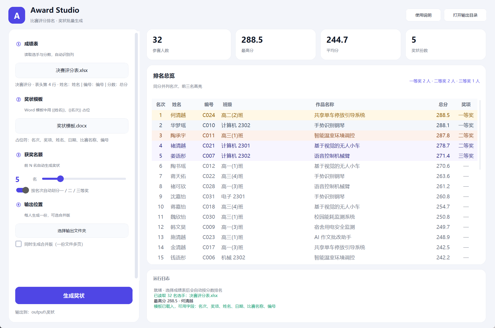
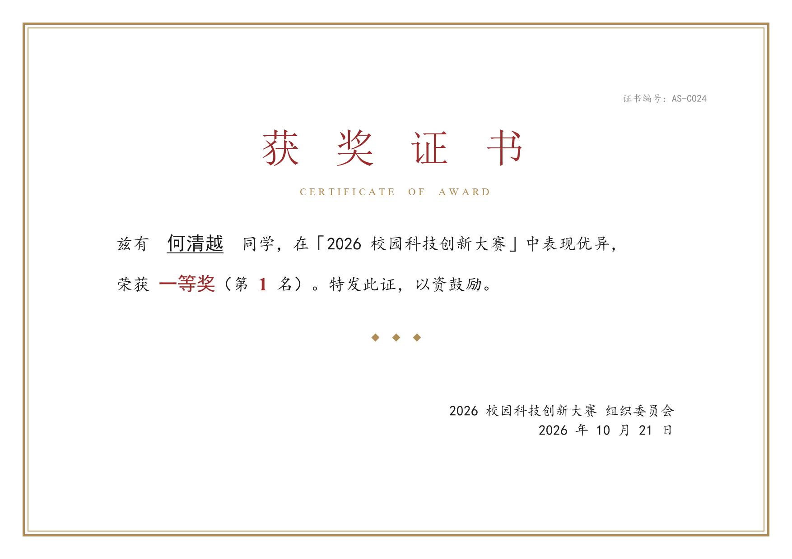

# Award Studio · 比赛评分与奖状生成

读一张 Excel 成绩表，自动按分数排名，再按 Word 模板给前 N 名批量生成奖状。界面用 CustomTkinter 写成，浅色、圆角卡片风格，双击即用。



## 它能做什么

- **自动认表**：表头不在第 1 行也能认（前面有标题、说明行无所谓），「姓名 / 选手 / 参赛者」「总分 / 成绩 / 得分 / 评分」这些列名都能识别
- **自动算分**：没有「总分」列、只有多个评委列时，直接把评委分相加；读不到缓存值时还能对 `=SUM(...)` 公式兜底计算
- **排序并列**：同分并列名次（1、2、2、4），前三名金/银/铜底色
- **批量出证**：前 N 名每人一份 Word，文件名形如 `01_张三_一等奖.docx`，也可以额外生成一份多页合并版
- **奖项分档**：按名额三等分自动划分一 / 二 / 三等奖，也可以关掉只用名次



## 快速开始

**方式一：直接运行 exe（推荐给非开发同学）**

双击 `dist/AwardStudio.exe` 即可，不需要装 Python。`samples` 文件夹是可选的——放在 exe 旁边，就可以在软件里直接选这两份示例文件试跑；不放也不影响正常使用。

**方式二：双击 `启动.bat`**

会自动检查依赖，缺什么装什么，然后打开界面并载入示例数据。

**方式三：命令行**

```bash
pip install -r requirements.txt
python app.py            # 正常启动
python app.py --demo     # 启动并自动载入 samples 里的测试数据
```

> 想自己重新打包 exe：
> ```bash
> pip install pyinstaller
> pyinstaller --noconfirm --clean --onefile --windowed --name AwardStudio ^
>   --icon assets/icon.ico --manifest assets/app.manifest ^
>   --collect-all customtkinter app.py
> ```

## 使用步骤

1. **选成绩表**：点「选择 Excel 成绩表」，选完立刻按分数排好序
2. **选奖状模板**：点「选择 Word 奖状模板」，界面会显示模板里认到的占位符
3. **设名额**：拖滑块定前 N 名，开关决定是否自动分一 / 二 / 三等奖
4. **选输出目录**：默认放在成绩表同级的 `output/奖状`
5. **点「生成奖状」**：完成后可直接打开输出文件夹；双击排名表里某一行，能打开这个人已生成的奖状

## 奖状模板怎么写

把模板里的固定内容照常排好，需要填空的位置写占位符（`{{姓名}}` 和 `【姓名】` 两种写法都认）：

| 占位符 | 内容 | 示例 |
|---|---|---|
| `{{姓名}}` | 选手姓名 | 何清越 |
| `{{名次}}` | 名次数字 | 3 |
| `{{名次中文}}` | 中文名次 | 第三名 |
| `{{奖项}}` | 奖项等级 | 二等奖 |
| `{{比赛名称}}` | 比赛名称 | 2026 校园科技创新大赛 |
| `{{日期}}` | 生成日期 | 2026 年 10 月 21 日 |
| `{{编号}}` | 选手编号 | C024 |
| `{{班级}}` | 成绩表里的任意列 | 高二(5)班 |

最后一类很实用：成绩表里 `班级`、`作品名称`、`指导老师` 这些列，都能用 `{{列名}}` 直接写进奖状。

模板不限版式，横向 A4、竖版、带边框、带校徽图片都行。占位符被 Word 拆成好几段格式（比如姓名单独加粗）也不影响替换。

## 成绩表长什么样

`samples/决赛评分表.xlsx` 就是一份可以直接用的示例，结构如下：

| 编号 | 姓名 | 班级 | 作品名称 | 评委一 | 评委二 | 评委三 | 总分 |
|---|---|---|---|---|---|---|---|
| C001 | 何清越 | 高二(5)班 | 智能垃圾分类装置 | 96.1 | 96.2 | 96.2 | `=SUM(E2:G2)` |

- 表头上方可以有标题、说明行，软件在前 20 行里定位表头
- 列顺序随意，多余列会被忽略
- 分数可以带单位（`95.5 分`），空分数的那行会跳过并在日志里提示

## 测试数据

`samples/` 里两份文件由脚本随机生成（32 名选手、三位评委打分）：

```bash
python tools/make_samples.py        # 重新生成成绩表 + 奖状模板
python tools/smoke_test.py          # 无界面跑一遍：读表 → 排名 → 出证 → 校验
```

自测会检查：人数、分数解析、降序排列、并列名次、占位符替换、单人文件与合并版是否完整。

## 项目结构

```
AwardStudio/
├── app.py                     界面主程序
├── core/
│   ├── excel_reader.py        成绩表解析（表头定位、列识别）
│   ├── formula.py             SUM 等公式兜底求值
│   ├── ranking.py             排名、并列名次、奖项分档
│   └── certificate.py         占位符替换、批量生成、合并多页
├── tools/
│   ├── make_samples.py        生成测试用 Excel + Word 模板
│   ├── smoke_test.py          端到端自测
│   ├── preview_gui.py         界面截图（文档用）
│   └── render_sample_preview.py  奖状效果图渲染
├── samples/                   测试数据
├── output/                    生成的奖状
└── requirements.txt
```

## 常见问题

**读不到分数？** 分数列必须有表头，且表头里要出现「分 / 成绩 / 得 / 评」这类字。如果那一列是文本（比如 `A`、`优`），软件没法排序，会在日志里提示跳过了哪几行。

**模板生成失败？** 多半是模板里没有占位符。选完模板后看左栏提示：显示「占位符：姓名、名次…」才说明认到了。

**提示文件被占用？** 同名奖状正在 Word 里打开着，关掉再生成。

**同分怎么排名次？** 同分同名次，后面的名次跳号。例如 3 人同分并列第 2，下一位是第 5。名额按人数取，不受并列影响。
